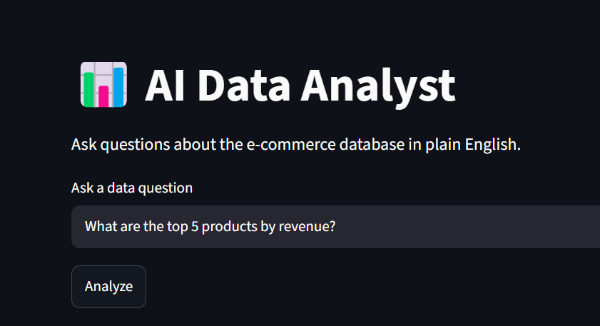
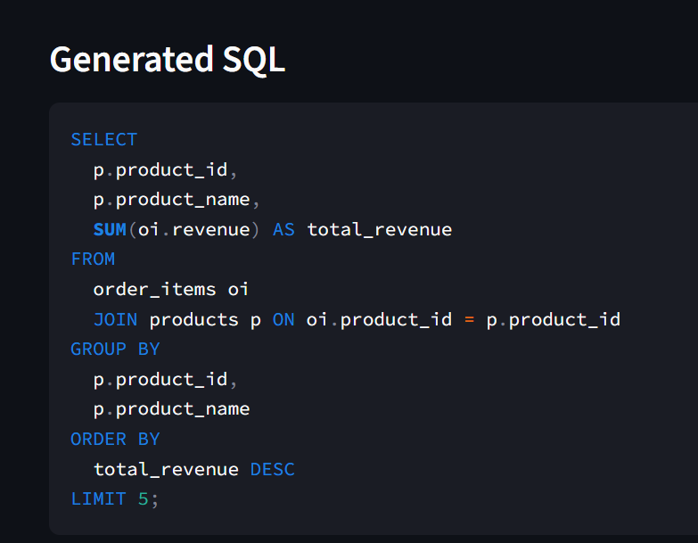
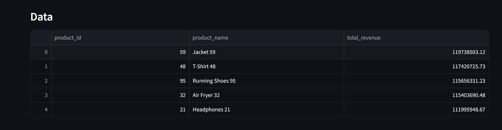
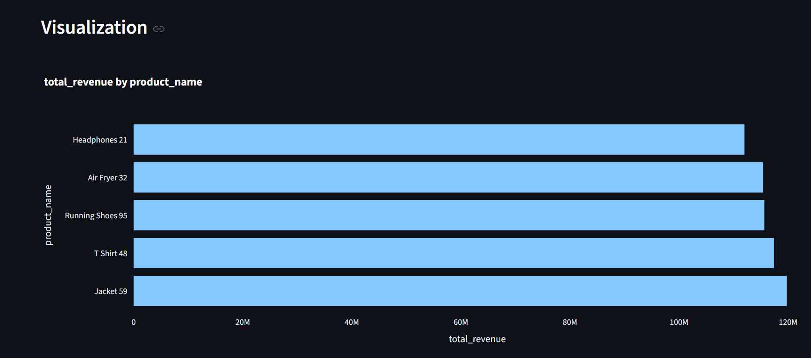
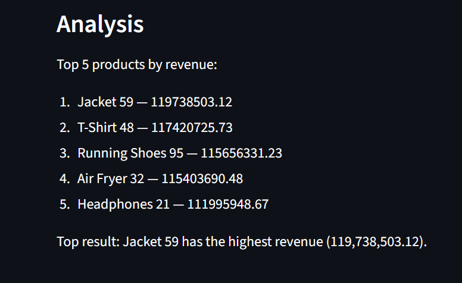

# AI Data Analyst Agent

An AI-powered data analytics application that converts natural-language questions into SQL queries, executes validated queries against PostgreSQL, and presents results through interactive visualizations and AI-generated explanations.

**[🚀 Live Demo](https://ai-data-analyst-agent-dz8zu9kmqdrjpcwa5f74so.streamlit.app/)**

## Key Features

- **Natural Language to SQL:** Ask business questions in plain English.
- **SQL Validation:** Parse and validate generated SQL before execution.
- **Database Integration:** Query a hosted PostgreSQL database using a read-only application account.
- **Interactive Analytics:** Display query results in tables and charts.
- **AI-Generated Insights:** Receive natural-language explanations of query results.
- **Cloud Deployment:** Deployed using Streamlit Community Cloud and Neon PostgreSQL.

## Technology Stack

Python · Streamlit · PostgreSQL · OpenAI API · Pandas · Plotly · SQLGlot · Neon

## Dataset

The application uses a synthetically generated e-commerce dataset containing customers, products, orders, and order items. It is intended to demonstrate an analytics workflow and does not represent real customer transactions.

## Example Questions

- Which product categories generate the highest revenue?
- How does monthly revenue change over time?
- Which cities have the most customers?
- Which products contribute the most to sales?

## Architecture

User Question → LLM-Based SQL Generation → SQL Validation → PostgreSQL Execution → Results Table and Visualization → AI-Generated Explanation

## Security Notes

- API keys and database credentials are stored in environment variables or Streamlit secrets, not in source control.
- The deployed application uses a read-only database account.
- SQL parsing and validation provide an additional safeguard, but do not replace database permissions, query timeouts, and other security controls.

**Note:** The dataset is synthetic, and generated insights depend on the quality of the SQL and the underlying data.


## Application Preview







## Local Setup

### 1. Clone the repository

```bash
git clone <YOUR_GITHUB_REPOSITORY_URL>
cd ai-data-analyst-agent
```

### 2. Install dependencies

Install [uv](https://docs.astral.sh/uv/) if necessary, then run:

```bash
uv sync
```

If your project dependencies have not yet been recorded in `pyproject.toml`, add the packages used by the application before running `uv sync`.

### 3. Configure environment variables

Create a `.env` file in the project root:

```dotenv
OPENAI_API_KEY=your_openai_api_key
DB_HOST=localhost
DB_PORT=5432
DB_NAME=ai_analyst
DB_USER=ai_analyst_reader
DB_PASSWORD=your_database_password
```

Never commit real API keys or passwords.

### 4. Set up PostgreSQL

Install and start PostgreSQL. Create the `ai_analyst` database and the four tables described above.

Create a dedicated database account with read-only access to the required tables.

### 5. Generate sample data

Configure the database connection in your data-generation script and run:

```bash
uv run python data/generate_data.py
```

Run this only when the database tables are empty or when you have intentionally prepared them for a fresh data load.

### 6. Launch the application

From the project root:

```bash
uv run python -m streamlit run frontend/dashboard.py
```

Open the local URL displayed in the terminal.

### 7. Run tests

```bash
uv run python app/test_validator.py
```


## Author

**Raghav Ratan Yadav**

Integrated M.Sc. Mathematics | Data Analytics | Python | SQL | PostgreSQL | Generative AI
